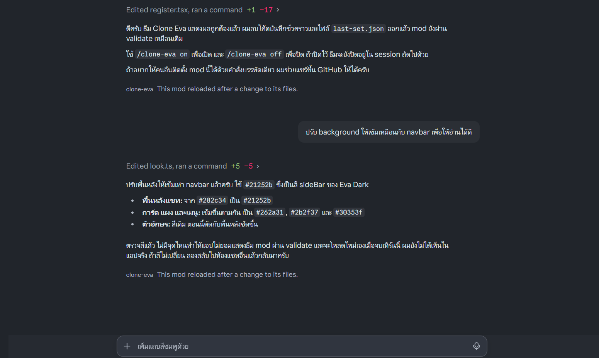

# eva-virtual-theme

A Claude Code mod named `eva-virtual-theme`: a flat dark look modelled on the Eva Dark VS Code theme.
Drawn by the Claude desktop and mobile apps only; the terminal and editors draw no theme.

## Screenshot



## Install

At the prompt of a terminal session:

```
/plugin install eva-virtual-theme --marketplace tp-job/eva-virtual-theme
```

Answer `y` to add the marketplace, then pick a scope.

## Use

| Command | Does |
| --- | --- |
| `/clone-eva on` | Turns the look on (it is on by default) |
| `/clone-eva off` | Turns it off, and keeps it off in later sessions |
| `/clone-eva` | Says whether it is on or off |

`/clone-eva off` clears whatever theme stands, whichever mod set it.

## Change the colors

Edit `hooks/look.ts`: the surfaces, text and roles are named there with the Eva Dark values they follow.
